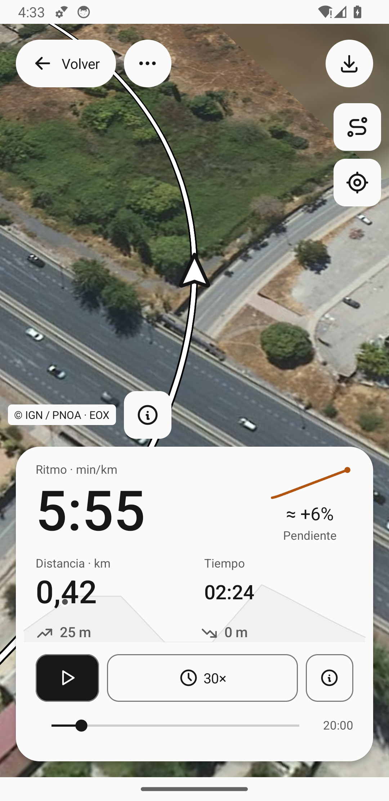
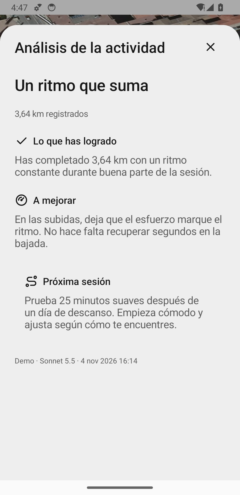
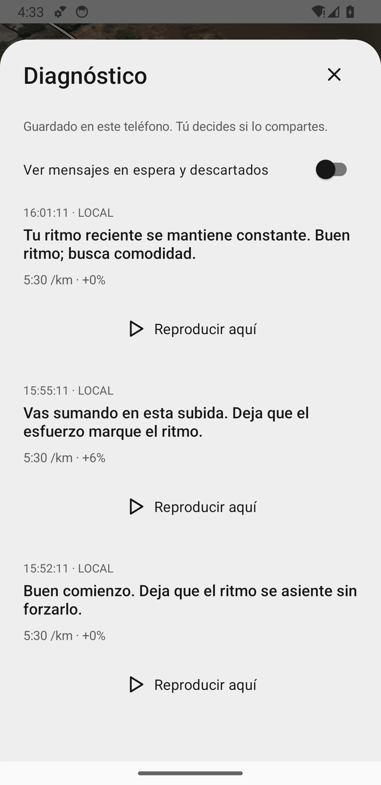

# Runline

An open-source Android app for runs, walks and hikes. GPS recording, local history, satellite maps, route replay and GPX/CSV exports. Optional voice coaching and AI goals. English and Spanish.

<table><tr><td></td><td></td><td></td></tr></table>

Actual app screens with synthetic demo data. [Image details](docs/images/README.md).

**New in 0.20.2:** add your own routes. **Routes → Add route** opens Files, or open/share any downloaded GPX with Runline. It suggests a name like “Granada, Los Pinos – Puente Romano loop 10.3K” from the route's town, places, shape and distance; keep it or type your own. [Hiking and routes](docs/HIKING.md#routes-tab).

**In 0.20.1:** elevation on mountain paths. Replays, the elevation chart and the route preview no longer go blank on steep hillsides; only bridges, underpasses and other real steps stay hidden. [Terrain](docs/TERRAIN.md#hillsides-0201).

**In 0.20:** navigation on a route. Spoken turns about 80 m and 20 m ahead, with a GPS-style arrow. The next climb, and a profile of the height ahead. Short notes about the places you pass. Preview a route in 3D, then start it with one tap. The Granada loop is cleaned up and annotated. [Hiking and routes](docs/HIKING.md).

**In 0.19:** hiking routes. A Routes tab with open routes you can download and share, starting with a loop from the Alhambra across the Dehesa del Generalife and back along the Genil. Import any GPX, see distance, ascent, time and sunset, then follow it with off-route alerts. [Hiking and routes](docs/HIKING.md), [open routes](routes/README.md).

**In 0.18:** no more slope or elevation cut-outs on bridges and in underpasses: Runline works out whether you were above or below the road. In replay, the arrow draws your route as it goes. A recenter arrow and smaller map credits.

**In 0.17:** auto-pause at traffic lights and other stops, with moving time and pace. Steadier slope readings at bridges and underpasses. A coach that speaks real splits and progress. One-tap ZIP with all of a run's data. An optional AI-maintained runner profile.

**In 0.16:** a simpler Record screen, optional daily AI suggestion with a session-specific Use switch, automatic nearby terrain, GitHub update checks and storage usage in About, compact sharing controls, inline pace units and a replay-speed slider. [Using Runline](docs/USAGE.md).

## Get started

1. Install the APK from [Releases](https://github.com/adrianetti/runline/releases/latest) on Android 8.0+.
2. Choose **Run**, **Walk** or **Hike**, allow precise location, and tap **Start** outdoors.
3. **Pause**, **Resume** or **Finish**; find saved recordings in **Activities**.

Recordings stay on your phone. **Export important activities before uninstalling or clearing app data.** Maps need internet; AI is off by default and uses your own Anthropic key.

## Build

Use JDK 17, Android SDK 37.0 and Build Tools 36.0.0. Set `ANDROID_HOME` to your SDK.

```sh
./gradlew testDebugUnitTest assembleDebug assembleRelease lintDebug
```

## Contribute

[MIT licensed](LICENSE) · [Contributing](CONTRIBUTING.md) · [Security](SECURITY.md). Third-party assets and map services keep their own licenses. Global EOX imagery has noncommercial restrictions; source availability does not remove those terms.

Google Play publication is deferred until a developer account and the remaining release checks are ready. Signed GitHub APKs remain the update channel.

## More

- [Usage](docs/USAGE.md) · [Development](docs/DEVELOPMENT.md) · [Repository checks](docs/CHECKS.md)
- [Maps](docs/MAPS.md) · [Coaching](docs/COACHING.md) · [AI](docs/AI.md) · [Goals](docs/GOALS.md) · [Exports](docs/EXPORTS.md)
- [Coach diagnostics](docs/DIAGNOSTICS.md) · [Distribution and Google Play plan](docs/PUBLISHING.md)
- [Testing and known limits](docs/TESTING.md) · [Release history](docs/RELEASE-HISTORY.md) · [Third-party notices](THIRD_PARTY_NOTICES.md)

Prototype: controlled physical-phone field and battery tests remain outstanding.
